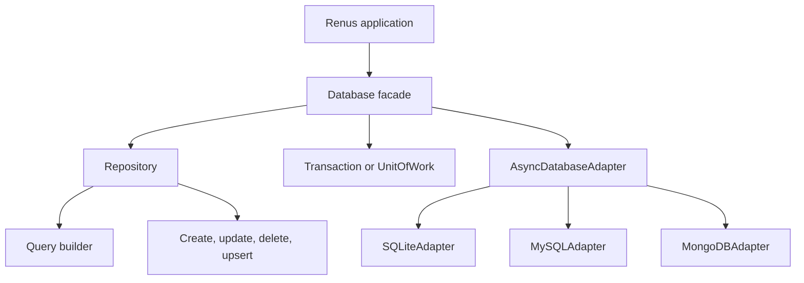

# Database Overview

Renus provides an asynchronous database layer built around declarative models, repositories, immutable query builders, and pluggable database adapters. The high-level `Database` object coordinates connections, repositories, transactions, migrations, plugins, schema creation, and backup/restore operations.


## Architecture



The main layers are:

- **Models** describe application data, validation rules, database field metadata, relationships, and lifecycle state.
- **Repositories** bind a model to a database connection and expose persistence and query operations.
- **Queries** build an immutable query structure that adapters compile and execute.
- **Adapters** implement the asynchronous backend interface. Renus includes SQLite, MySQL, and MongoDB adapters.
- **Transactions and units of work** define the boundary for atomic database work.
- **Migrations** apply and track versioned schema changes.
- **Plugins** receive connection, query, mutation, and error lifecycle hooks.

## Installation and backend dependencies

The database backends are exposed by the package, while backend-specific client dependencies are optional:

```bash
pip install renus
pip install renus[mysql]  # MySQL support
pip install renus[mongo]  # MongoDB support
```

SQLite uses Python's standard-library `sqlite3` module and does not require an additional Renus extra. 

## Connecting to a database

Construct a `Database` with an adapter, connect it before using schema or repository operations, and disconnect it when the application is finished. The database is an asynchronous context manager, which handles this lifecycle automatically.

```python
from renus.db import Database, SQLiteAdapter


db = Database(SQLiteAdapter({"database": "storage/app.sqlite"}))


async def open_database() -> Database:
    await db.connect()
    return db


async def close_database() -> None:
    await db.disconnect()
```

For a short-lived operation, use the context-manager form:

```python
from renus.db import Database, SQLiteAdapter


async def check_database() -> bool:
    async with Database(SQLiteAdapter({"database": ":memory:"})) as db:
        return await db.health_check()
```

`Database.connect()` and `Database.disconnect()` operate on every registered connection by default. Pass a connection name to operate on one connection only.

## Configuring adapters

`Database` supports one primary adapter and any number of named adapters. An adapter can be supplied directly, or resolved from `Config("database")` using an adapter instance, a callable factory, or a registered driver name.

```python
from renus.db import Database, SQLiteAdapter


primary = SQLiteAdapter({"database": ":memory:"})
analytics = SQLiteAdapter({"database": "storage/analytics.sqlite"})

db = Database(adapters={"primary": primary, "analytics": analytics})

primary_repo = db.repository(MyModel)
analytics_repo = db.repository(MyModel, connection="analytics")
```

The built-in adapter names are `sqlite`, `mysql`, and `mongodb`. Adapter names can also be registered explicitly or loaded through the `db.adapters` and `renus.db.adapters` entry-point groups. See [Adapters](adapters.md) for backend-specific behavior and configuration.

## Defining models

Models subclass `Model` and use Python annotations together with `Field` and `DatabaseField` declarations. Renus builds model metadata when the class is created. That metadata includes fields, storage types, identity fields, indexes, relationships, timestamps, and soft-delete settings.

```python
from renus.db import DatabaseField, Field, Model


class User(Model):
    id: str = Field(database=DatabaseField(primary_key=True))
    username: str = Field(database=DatabaseField(unique=True))
    name: str | None = None
    active: bool = True

    class Meta:
        timestamps = True
        soft_delete = True
```

A model's table defaults to the lowercase plural of its class name, so `User` maps to `users` unless `Meta.table` supplies another name. If a model does not declare an identity field, model metadata creates a generated integer `id` field. Identity behavior can also be configured with `DatabaseField` and the database `ID` configuration.

`Field` is responsible for validation, coercion, defaults, and sensitive-value masking. `DatabaseField` supplies storage metadata such as:

- `primary_key` and `auto_inc`
- `column_name` and `storage_type`
- `nullable`, `default`, and `default_factory`
- `unique` and `indexed`
- `foreign_key`, `on_delete`, and `on_update`
- `generated`, `immutable`, and `comment`

Relationships such as `Embedded`, `EmbeddedMany`, `OneToOne`, `OneToMany`, `ManyToOne`, `ManyToMany`, and `Reference` are also available from `renus.db`. See [Models & Fields](models.md) for model metadata, field validation, identities, and relationships.

## Creating the schema

Adapters expose schema creation for a collection of models. Connect first, then call `create_schema`:

```python
from renus.db import Database, DatabaseField, Field, Model, SQLiteAdapter


class User(Model):
    id: str = Field(database=DatabaseField(primary_key=True))
    name: str


async def prepare_database() -> Database:
    db = Database(SQLiteAdapter({"database": ":memory:"}))
    await db.connect()
    await db.create_schema([User])
    return db
```

For evolving an existing schema, use migrations rather than relying only on schema creation. See [Migrations](migrations.md).

## Repositories and persistence

A repository binds one model to one named connection:

```python
repo = db.repository(User)
```

The primary repository connection is named `primary`. Pass another name when using multiple adapters:

```python
repo = db.repository(User, connection="analytics")
```

Repository persistence methods are asynchronous:

```python
user = await repo.create(User(id="u1", name="Ada"))

user.name = "Ada Lovelace"
await repo.save(user)

created = await repo.create_many(
    [
        User(id="u2", name="Grace Hopper"),
        User(id="u3", name="Edsger Dijkstra"),
    ]
)
```

The main persistence operations are:

- `create(model)` and `create_many(models)` insert models.
- `save(model)` inserts new models and updates persisted dirty models.
- `update(...)` and `update_many(...)` update matching rows from a values dictionary.
- `delete(...)` and `delete_many(...)` delete models or matching rows.
- `hard_delete(...)` and `hard_delete_many(...)` physically remove rows, bypassing soft deletion.
- `upsert(...)` inserts or updates on a conflict target.
- `count(...)` and `exists(...)` provide direct aggregate checks.

After a successful insert, Renus marks the model as persisted and populates adapter-generated values when available. Model instances track states such as new, persisted, dirty, deleted, and detached; inspect `is_new`, `is_persisted`, `is_dirty`, `is_deleted`, `dirty_fields`, and `get_dirty_changes()` when coordinating application changes.

## Queries

`repository.query()` and `repository.where()` return an immutable `Query` builder. Each method returns a new query, so a base query can be safely reused:

```python
active_users = repo.where(User.active == True)

first_user = await active_users.order_by(User.name.asc()).first()
all_users = await active_users.order_by(User.name.asc()).all()
number_of_users = await active_users.count()
has_users = await active_users.exists()
```

Field paths create conditions with Python comparisons and explicit operators:

```python
from renus.db import Q


query = repo.where(
    Q(User.active == True, User.name.is_not_null())
)

recent = await query.select(User.id, User.name).limit(20).all()
```

Supported query operations include:

- filtering with `where()` or `filter()`
- projections with `select()`
- ordering with `order_by()`, `asc()`, and `desc()`
- pagination with `offset()`, `limit()`, and `paginate()`
- cursor positioning with `cursor()`
- eager relationship loading with `include()`
- grouping and aggregates with `group_by()`, `aggregate()`, and `having()`
- `distinct()` results
- soft-delete scopes with `with_deleted()` and `only_deleted()`

A normal query returns hydrated model instances. A query with a projection or aggregate returns dictionaries containing the selected result data. See [Queries](queries.md) for the complete query API and condition operators.

## Transactions and units of work

Use `Database.transaction()` when a block of operations should commit or roll back as one transaction:

```python
async with db.transaction():
    await repo.create(User(id="u4", name="Katherine Johnson"))
    await repo.create(User(id="u5", name="Dorothy Vaughan"))
```

The transaction context commits when the block exits without an exception and rolls back when an exception escapes. The adapter does not support nested transactions.

Use `Database.unit_of_work()` when several repositories should share one transactional boundary:

```python
async with db.unit_of_work() as work:
    users = work.repository(User)
    posts = work.repository(Post)
    await users.create(User(id="u6", name="Alan Turing"))
    await posts.create(Post(id="p1", title="Programming"))
    await work.commit()
```

A `UnitOfWork` caches repositories by model and exposes `commit()` and `rollback()`. If the unit of work exits without an explicit commit, its current transaction is rolled back. See [Transactions](transactions.md) and [Unit of Work](uow.md) for the detailed semantics.

## Migrations

A migration manager is bound to a database and migration directory:

```python
migrations = db.migration_manager(path="migrations")

await migrations.upgrade()
```

Migration files are Python files in the migration directory. Renus discovers files with names such as `0001_create_users.py`, calls their `upgrade(adapter)` or `downgrade(adapter)` function, and records a SHA-256 checksum for applied migrations. The manager also supports creating migration files, checking status and checksums, applying up to a target, downgrading, resetting, and fake migrations. See [Migrations](migrations.md) for file structure and workflow.

## Backups and restore

The `Database` facade delegates backup and restore operations to the selected adapter:

```python
backup_counts = await db.backup(
    path="storage/db-backup",
    tables=["users"],
)

restore_counts = await db.restore(
    path="storage/db-backup",
    tables=["users"],
    drop_existing=True,
)
```

Both methods return a dictionary of table names and row counts. See [Backup & Restore](backup.md) for the supported backup format and operational details.

## Choosing the next page

- [Models & Fields](models.md) — declare models, fields, identities, relationships, and metadata.
- [Queries](queries.md) — build and execute filters, projections, ordering, pagination, and aggregates.
- [Mutations](mutations.md) — insert, update, delete, and upsert data.
- [Repositories](repositories.md) — organize model persistence behind repository objects.
- [Unit of Work](uow.md) — coordinate repositories in one application operation.
- [Transactions](transactions.md) — control commit and rollback boundaries.
- [Migrations](migrations.md) — evolve and track database schemas.
- [Adapters](adapters.md) — configure and extend database backends.
- [Backup & Restore](backup.md) — protect and recover stored data.
